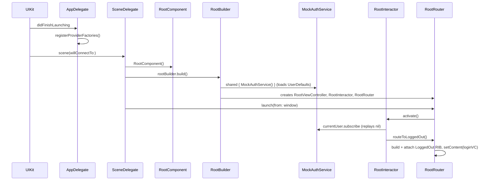
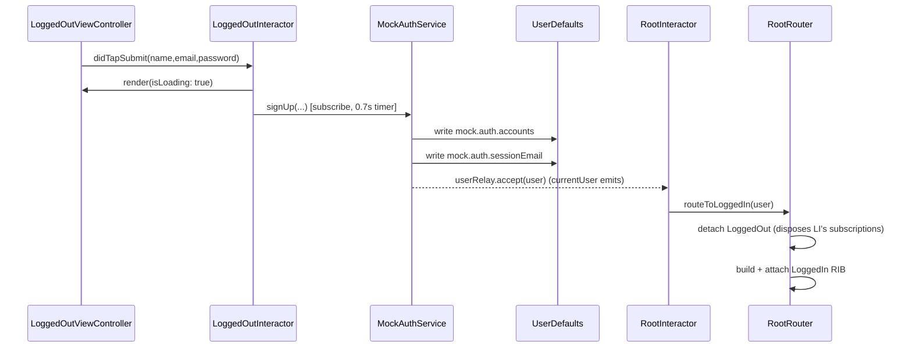
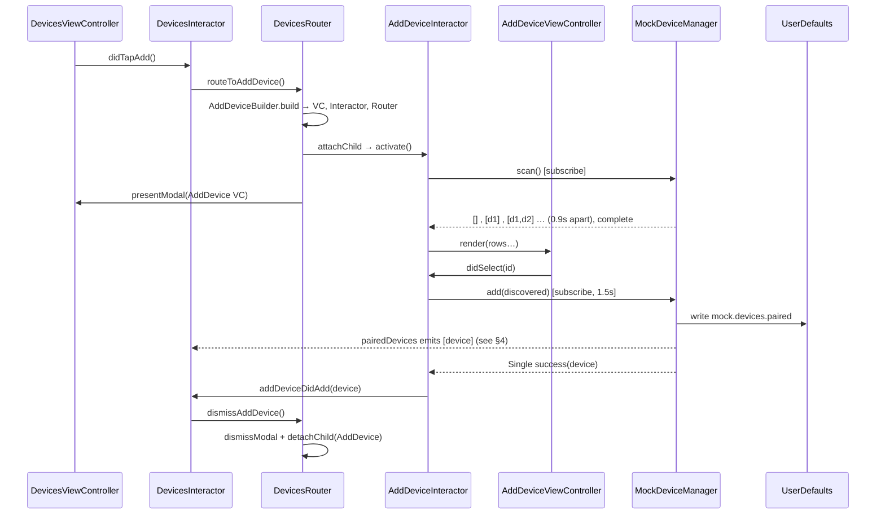
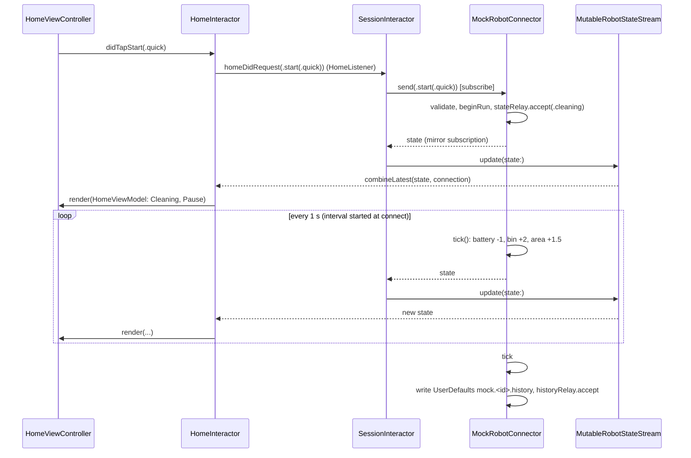

# RibRoomba — Runtime sequences

This document follows **one complete user journey** through the code, step by step, and for each step says:

* **what is created, and by whom** (objects, RIBs, components);
* **who talks to whom** (calls, listener protocols);
* **the reactive flow** (which `Observable` feeds which subscriber, on which scheduler, who disposes it);
* **where data lives** (memory vs. `UserDefaults`).

Read [ARCHITECTURE.md](ARCHITECTURE.md) first for the vocabulary (RIB, Component, Builder, Listener, Session…).

| # | Step | Section |
|---|------|---------|
| 0 | Conventions used below | [§0](#0-conventions-and-ground-rules) |
| 1 | Starting the app | [§1](#1-starting-the-app) |
| 2 | Signing up | [§2](#2-signing-up) |
| 3 | Adding a device | [§3](#3-adding-a-device) |
| 4 | Showing the added device | [§4](#4-showing-the-added-device) |
| 5 | Opening the device and running a cleaning run | [§5](#5-opening-the-device-and-doing-a-cleaning-run) |
| 6 | Seeing the run in History | [§6](#6-seeing-the-run-in-history) |
| 7 | Where all data is stored | [§7](#7-where-data-is-stored) |

---

## 0. Conventions and ground rules

### Who creates what (the creation rules)

1. **Components create Builders** (a component's computed property returns `XBuilder(dependency: XComponent(parent: self))`).
   A child component is always created by its *parent* component.
2. **Builders create everything else** of a RIB: view controller, interactor, router. Nothing else instantiates them.
3. **Routers create child RIBs** by calling the child's `Buildable.build(...)`, then `attachChild`.
4. **Services (`MockAuthService`, `MockDeviceManager`) are created lazily by `RootComponent`** (`shared { … }`, one
   instance per app run). The robot connector is created by `MockDeviceManager.connector(for:)`, one per device.

### Ownership (strong references)

```
SceneDelegate ──► launchRouter (RootRouter)
Router ──► its Interactor           (Router.interactor)
Router ──► its ViewController        (ViewableRouter.viewController)   [view-backed RIBs only]
Router ──► its attached children     (Router.children)
Interactor ──► its Presenter (= the ViewController)    (PresentableInteractor.presenter)
─ weak ─►  ViewController.listener (= its Interactor)   Interactor.router   Interactor.listener (= parent's interactor)
```

So an interactor never strongly references its parent, and a view never strongly references its interactor. Detaching a
child router from `children` releases the whole RIB (RIBs' `LeakDetector` asserts this in debug).

### Reactive ground rules

* **Subscribe in `didBecomeActive()`, end with `.disposeOnDeactivate(interactor: self)`.** When a RIB is detached, its
  interactor is deactivated and *every* such subscription is disposed automatically. There are no dispose bags.
* **State comes from replaying `Observable`s** (`BehaviorRelay.asObservable()` underneath). Subscribing immediately
  delivers the latest value, so a freshly attached RIB renders without waiting for a change.
* **`.observe(on: MainScheduler.instance)`** is used before touching a view. RxSwift runs the callback *inline* when
  already on the main thread with nothing queued, and on the next main-queue turn otherwise; the code does not depend
  on which.
* **Cold vs. hot.** `Single`/`Completable` returned by services are *cold*: nothing happens (no timer, no mutation)
  until someone subscribes. Relays are *hot* and private to their owner.
* **Time in the mocks** is real time on `MainScheduler`: auth latency 0.7 s, scan step 0.9 s (4 steps), pairing 1.5 s,
  connect 1.2 s, robot tick 1 s (= one simulated minute).
* Names: `VC` = view controller, `presenter` = the VC seen through the `…Presentable` protocol, `stream` = the session's
  `MutableRobotStateStream`.

---

## 1. Starting the app

Assume a fresh install (nothing in `UserDefaults`). The restored-session variant is noted at the end of the section.

### 1.1 Process start (UIKit → our code)

| Order | Who | What |
|---|---|---|
| 1 | UIKit | Calls `@main AppDelegate`, `application(_:didFinishLaunchingWithOptions:)` |
| 2 | `AppDelegate` | Calls **`registerProviderFactories()`** (generated `NeedleGenerated.swift`). This fills Needle's global `__DependencyProviderRegistry` with a factory per component *path* (`"^->RootComponent->LoggedInComponent->SessionComponent->HomeComponent"` …). **No component exists yet.** It must run before the first `Component` is created, because `Component.init(parent:)` immediately looks its provider factory up in this registry. |
| 3 | UIKit | Asks `application(_:configurationForConnecting:options:)` for a scene configuration; `AppDelegate` returns one whose `delegateClass` is `SceneDelegate` (UIScene lifecycle is mandatory on the iOS 27 SDK) |
| 4 | UIKit | Creates the window scene and calls `SceneDelegate.scene(_:willConnectTo:options:)` |

### 1.2 Building the RIB tree root (`SceneDelegate`)

```swift
let window = UIWindow(windowScene: windowScene)
let router = RootComponent().rootBuilder.build()   // creates the Root RIB
launchRouter = router                               // SceneDelegate keeps the whole tree alive
router.launch(from: window)
```

**Creation order inside `RootComponent().rootBuilder.build()`:**

| Order | Created | By | Notes |
|---|---|---|---|
| 1 | `RootComponent` | `SceneDelegate` | A Needle `BootstrapComponent`; has no parent and no dependencies |
| 2 | `RootBuilder` | `RootComponent.rootBuilder` | `RootBuilder(dependency: self)` — the builder holds the component |
| 3 | **`MockAuthService`** | `RootBuilder.build()` reading `dependency.authService` → `shared { MockAuthService() }` | **Init loads storage**: decodes accounts from `UserDefaults["mock.auth.accounts"]`, adds the seeded demo account (`demo@ribroomba.app`), and reads `UserDefaults["mock.auth.sessionEmail"]`. If a session email exists and matches an account, `userRelay` starts with that `User`; otherwise it starts with `nil`. |
| 4 | `RootViewController` | `RootBuilder` | An empty container (`UIViewController`) |
| 5 | `RootInteractor` | `RootBuilder` | `RootInteractor(presenter: viewController, authService:)` |
| 6 | `LoggedOutBuilder` + `LoggedOutComponent` | `RootBuilder` via `dependency.loggedOutBuilder` | `LoggedOutComponent(parent: rootComponent)`: Needle looks up `"^->RootComponent->LoggedOutComponent"` in the registry and builds a `LoggedOutDependency` provider that will forward `authService` to the root component |
| 7 | `LoggedInBuilder` + `LoggedInComponent` | `RootBuilder` via `dependency.loggedInBuilder` | Same mechanism; its provider forwards `deviceManager` (not touched yet, so **`MockDeviceManager` does not exist yet**) |
| 8 | `RootRouter` | `RootBuilder` | `LaunchRouter` subclass. Its init sets `interactor.router = self` (weak back-reference) |

Nothing else exists: no LoggedIn subtree, no session, no connector.

### 1.3 Launching

`router.launch(from: window)` (RIBs' `LaunchRouter`):

1. `window.rootViewController = RootViewController`, `window.makeKeyAndVisible()`
2. **`interactable.activate()`** → `RootInteractor.didBecomeActive()` runs.
3. **`load()`** → `Router.didLoad()` (Root's router has nothing to do there).

### 1.4 Reactive flow: Root decides what to show

```
MockAuthService.userRelay (BehaviorRelay<User?>)
   └─ .asObservable()  =  authService.currentUser                       replays the current value on subscribe
       └─ .distinctUntilChanged { $0?.id == $1?.id }                   ignores repeat emissions for the same user
           └─ .observe(on: MainScheduler.instance)
               └─ .subscribe(onNext:)  ─►  user != nil ? router.routeToLoggedIn(user:) : router.routeToLoggedOut()
                   └─ .disposeOnDeactivate(interactor: RootInteractor)           lives as long as Root is active (app lifetime)
```

On a fresh install the replayed value is `nil`, so `RootRouter.routeToLoggedOut()` runs:

| Order | What | Detail |
|---|---|---|
| 1 | `detachCurrent()` | Nothing attached yet |
| 2 | `LoggedOutBuilder.build()` | Creates **`LoggedOutViewController`**, **`LoggedOutInteractor`** (`authService` read through `dependency.dependency.authService` → the Needle provider → `RootComponent.authService` → *the same shared `MockAuthService`*), and **`LoggedOutRouter`**. In the interactor's init, `presenter.listener = self` wires the view's actions to it. |
| 3 | `attachChild(router)` | RIBs activates the child interactor **first** (`LoggedOutInteractor.didBecomeActive()` → `presenter.render(viewModel)`; the VC's view isn't loaded yet, so `render` calls `loadViewIfNeeded()`), then `load()`s the router |
| 4 | `viewController.setContent(router.viewControllable)` | `RootViewController` adds the login VC as a child view controller (no animation: there was no previous content) |

**Result on screen:** the login form. **Storage touched in this step:** only *reads* of `UserDefaults` by
`MockAuthService`.

### 1.5 Variant: app launched while already signed in

If `mock.auth.sessionEmail` exists, step 1.4 receives a `User` and runs `routeToLoggedIn(user:)` instead — the same
code path as a fresh login in §2 (this is deliberate: *Root derives its child from `currentUser`*). The login screen is
never created.



---

## 2. Signing up

User taps **Sign up**, enters name/email/password, taps **Create account**.

### 2.1 Switching mode (pure view-model round trip)

```
SegmentedControl.valueChanged
 └─ LoggedOutViewController.modeChanged()
     └─ listener.didSelect(mode: .signUp)                     (LoggedOutPresentableListener, implemented by the interactor)
         └─ LoggedOutInteractor: viewModel = LoggedOutViewModel(mode: .signUp, isLoading: false, errorMessage: nil)
             └─ didSet { presenter.render(viewModel) }
                 └─ VC: shows the Name field, title "Create account"
```

No service call, no router call, no storage. The mode lives only in the interactor's `viewModel` (memory).

### 2.2 Submitting

```
Button tap ─► LoggedOutViewController.submitTapped()
  └─ listener.didTapSubmit(name:email:password:)                           view → interactor
      └─ LoggedOutInteractor.didTapSubmit
          ├─ guard !isLoading                                                (double-tap protection)
          ├─ viewModel.isLoading = true ─► render  (button "Please wait…", fields disabled, spinner)
          └─ authService.signUp(name:email:password:)  ──► Single<User>      COLD: nothing has happened yet
               .observe(on: Main)
               .subscribe(onFailure: { isLoading = false; errorMessage = error.localizedDescription })
               .disposeOnDeactivate(interactor: self)                         ← the subscription starts the work
```

### 2.3 Inside `MockAuthService.signUp` (the "backend")

`respond { … }` = `Single<Int>.timer(0.7 s, MainScheduler).map { _ in try work() }`. After 0.7 s `work()` runs
**synchronously, in this order**:

1. Validate: name non-empty → email regex → password ≥ 6 chars → email not already in `accounts`. A failed check
   `throw`s an `AuthError`, the `Single` errors, and the interactor shows the message (path 2.5).
2. Create `User(id: UUID().uuidString, name:, email: lowercased)`.
3. `accounts[email] = Account(user:, password:)` (memory) and **write the whole dictionary as JSON to
   `UserDefaults["mock.auth.accounts"]`**.
4. `startSession(user)`: **write `UserDefaults["mock.auth.sessionEmail"]`**, then **`userRelay.accept(user)`**.
5. Return the user → the `Single` would emit success.

### 2.4 The reaction: Root swaps subtrees (the interesting part)

Step 4 above *is* the navigation trigger. `userRelay.accept(user)` fires Root's long-lived subscription from §1.4:

```
userRelay.accept(user)
 └─ RootInteractor subscription (distinctUntilChanged: id changed nil → X)
     └─ RootRouter.routeToLoggedIn(user:)
         ├─ detachCurrent()
         │    └─ detachChild(LoggedOutRouter):
         │         LoggedOutInteractor.deactivate()  ─► every disposeOnDeactivate subscription is disposed
         │         (this includes the signUp subscription: its success callback is never delivered, and doesn't need to be)
         │         router removed from Root's `children` and from `current` ─► LoggedOut RIB deallocates
         ├─ LoggedInBuilder.build(withListener: RootInteractor, user:, host: RootViewController)   ← creates LoggedIn RIB
         ├─ current = router
         └─ attachChild(router)  ─► activate, then load  ─► LoggedInRouter.didLoad() ─► routeToDevices()   (see §3 / §4)
```

`LoggedInBuilder.build` creates: **`LoggedInInteractor`** (listener = `RootInteractor`, weak) and **`LoggedInRouter`**
(given the `host`, the `user`, a ready `DevicesBuilder`, and a *closure* that makes a fresh `SessionBuilder` on demand).
`LoggedIn` is **viewless**: it has no view controller; it places other RIBs' views into `host`
(`RootViewController`, through the `ContentHosting` protocol).

### 2.5 Failure path (e.g. password too short)

`work()` throws → `Single` fails → `LoggedOutInteractor`'s `onFailure` → `viewModel.isLoading = false`,
`viewModel.errorMessage = "Password must be at least 6 characters."` → `render` → the VC shows the red error label.
No `UserDefaults` writes happened (the validation precedes them), and Root is not notified.

### 2.6 Log in vs. sign up

Identical, except the interactor calls `signIn(email:password:)`; `work()` only *reads* `accounts`, checks the password,
and calls `startSession` (writing `sessionEmail`).



---

## 3. Adding a device

State on entry: `LoggedInRouter.didLoad()` has just called `routeToDevices()`. We first cover how the **Devices screen
appears**, then the add flow.

### 3.1 The Devices RIB appears (still part of the sign-up's tail)

`LoggedInRouter.routeToDevices()`:

| Order | Created | By | Notes |
|---|---|---|---|
| 1 | `DevicesBuilder` + `DevicesComponent` | `LoggedInComponent.devicesBuilder` (at LoggedIn build time) | `DevicesComponent(parent: loggedInComponent)` |
| 2 | **`MockDeviceManager`** | first read of `dependency.dependency.deviceManager` in `DevicesBuilder.build` → provider → `RootComponent.deviceManager` → `shared { MockDeviceManager() }` | **Init loads `UserDefaults["mock.devices.paired"]`** → `pairedRelay` (empty on a fresh install) |
| 3 | `DevicesViewController`, `DevicesInteractor(presenter:, user:, deviceManager:)`, `DevicesRouter` | `DevicesBuilder.build(withListener: LoggedInInteractor, user:)` | The router also receives `AddDeviceBuilder` (made from `DevicesComponent.addDeviceBuilder` → `AddDeviceComponent(parent: devicesComponent)`) |
| 4 | `attachChild(devicesRouter)` | `LoggedInRouter` | Activates `DevicesInteractor` → `didBecomeActive()` subscribes (below), then `load()` |
| 5 | `host.setContent(vc, embeddedInNavigation: true)` | `LoggedInRouter` | `RootViewController` wraps the list in a `UINavigationController` (it needs a nav bar for **Sign out** / **+**) and cross-fades from the login screen |

Subscription made in `DevicesInteractor.didBecomeActive()`:

```
deviceManager.pairedDevices            (BehaviorRelay<[Device]> in MockDeviceManager)
 └─ .observe(on: Main)
     └─ subscribe { devices in self.devices = devices;  presenter.render(makeViewModel(greeting: "Signed in as <name>", devices:)) }
         └─ .disposeOnDeactivate(interactor: DevicesInteractor)
```

The first emission is `[]` → the view shows "No robots yet. Tap + to search…".

### 3.2 Opening the search (modal child RIB)

```
nav bar "+"  ─► DevicesViewController.addTapped() ─► listener.didTapAdd()
  └─ DevicesInteractor.didTapAdd() ─► router?.routeToAddDevice()                     interactor → router (weak, via DevicesRouting)
      └─ DevicesRouter.routeToAddDevice():
          ├─ guard addDeviceRouter == nil                                              (no double presentation)
          ├─ addDeviceBuilder.build(withListener: interactor)                         creates AddDeviceViewController, AddDeviceInteractor, AddDeviceRouter
          │     └─ AddDeviceInteractor gets the SAME MockDeviceManager (Needle: AddDeviceComponent → DevicesComponent → LoggedInComponent → RootComponent)
          ├─ attachChild(router)      ─► AddDeviceInteractor.didBecomeActive()  (starts the scan, see 3.3)
          └─ viewController.presentModal(router.viewControllable)                    nav-wrapped, isModalInPresentation = true
```

`isModalInPresentation = true` means the user can only leave through the RIB's own **Cancel**/pairing success,
so the RIB can never stay attached with no view, nor the view stay without the RIB.

### 3.3 Scanning ("search")

`AddDeviceInteractor.didBecomeActive()` → `startScan()`:

1. `isScanning = true; discovered = []; render()` (spinner, "Searching for robots nearby…").
2. `scanDisposable.disposable = deviceManager.scan().observe(on: Main).subscribe(...)`.

`MockDeviceManager.scan()` is `Observable.deferred { … }`:

```
pool = nearby (4 hard-coded DiscoveredDevice) minus devices already in pairedRelay      ← evaluated at subscribe time
Observable.interval(0.9 s, MainScheduler).take(pool.count).map { Array(pool.prefix($0 + 1)) }.startWith([])
   emits:  []  →(0.9 s) [d1] →(1.8 s) [d1,d2] →(2.7 s) [d1,d2,d3] →(3.6 s) [d1..d4]  → completes
```

* `onNext` → `discovered = list; render()` → the VC reloads its table; rows appear one by one.
* `onCompleted` → `isScanning = false; render()` → header becomes "Tap a robot to add it." and a **Rescan** button appears.
* The `SerialDisposable` (`scanDisposable`) is itself disposed on deactivation, so closing the sheet mid-scan stops the
  timer. **Rescan** re-runs `startScan()` and replaces the previous subscription atomically.

Nothing is stored during scanning; the "found devices" list exists only in `AddDeviceInteractor.discovered`.

### 3.4 Pairing (the actual "add")

```
tap row ─► AddDeviceViewController.didSelectRow ─► listener.didSelect(id:)
 └─ AddDeviceInteractor.didSelect(id:)
     ├─ guard pairingID == nil, let target = discovered.first { $0.id == id }
     ├─ pairingID = id; errorMessage = nil; render()                 (row shows a spinner, other rows are disabled)
     └─ deviceManager.add(target)  ──► Single<Device>                 cold; the subscribe starts a 1.5 s timer
          .observe(on: Main)
          .subscribe(onSuccess: { pairingID = nil; listener?.addDeviceDidAdd(device) },
                     onFailure: { pairingID = nil; errorMessage = …; render() })
          .disposeOnDeactivate(interactor: self)
```

After 1.5 s, inside `MockDeviceManager.add`:

1. Check not already paired (else `DeviceError.alreadyAdded`).
2. `Device(id: discovered.id, name:, model:)` — **the device id is the discovered id**.
3. `pairedRelay.accept(existing + [device])` — **(hot emission #1)** → see §4.
4. **Write `UserDefaults["mock.devices.paired"]`** (JSON array).
5. The `Single` succeeds — **(emission #2)** → `AddDeviceInteractor.onSuccess`.

### 3.5 Closing the flow (child → parent → router)

```
AddDeviceInteractor ─ listener.addDeviceDidAdd(device) ─► DevicesInteractor            (AddDeviceListener, weak)
  └─ DevicesInteractor.addDeviceDidAdd ─► router?.dismissAddDevice()
      └─ DevicesRouter.dismissAddDevice():
          ├─ viewController.dismissModal()                        UIKit dismiss animation
          ├─ detachChild(addDeviceRouter)                         AddDeviceInteractor.deactivate() ⇒ pairing/scan subscriptions disposed
          └─ addDeviceRouter = nil                                 last strong ref gone ⇒ AddDevice RIB deallocates
```

**Cancel** takes the same route via `addDeviceDidCancel()` (no device is added; an in-flight pairing is cancelled by
the disposal because the timer subscription is torn down *before* the device is inserted).
Pairing failure keeps the sheet open and shows the error as the table footer.



---

## 4. Showing the added device

No new subscription is created for this step: it is the **hot emission #1** from §3.4 reaching the subscription
`DevicesInteractor` made back in §3.1 — which stayed alive underneath the modal.

```
MockDeviceManager.pairedRelay.accept([device])
 └─ DevicesInteractor subscription  (observe(on: Main))
     ├─ self.devices = [device]                                    kept for later lookups by id
     └─ presenter.render( DevicesInteractor.makeViewModel(greeting:, devices:) )
           = DevicesViewModel(greeting: "Signed in as …",
                              rows: [DeviceRowViewModel(id:, name:, subtitle: model)])
         └─ DevicesViewController.render → apply(): hides the empty label, tableView.reloadData()
               └─ cellForRowAt: name, model subtitle, fan icon, disclosure indicator
```

Points worth noticing:

* The list updated **while the modal was still covering it** (emission #1 precedes the dismissal), so when the sheet
  slides away the new row is already there.
* The **view never sees a `Device`** — only `DeviceRowViewModel` strings. A row tap goes back as just an `id`
  (`listener.didSelect(id:)`), and the interactor resolves it against its own `devices` array.
* **Storage:** the device is in `pairedRelay` (memory) and in `UserDefaults["mock.devices.paired"]`. After an app
  restart `MockDeviceManager.init` decodes it and the same subscription path shows it again, with no scan or pairing.
* **Removing** a device (swipe → delete): `DevicesInteractor.didDelete(id:)` → `deviceManager.remove(device)` → updates
  `pairedRelay`, rewrites the `UserDefaults` key and **drops the cached connector** for that device → the list
  re-renders through the exact same subscription.

---

## 5. Opening the device and doing a cleaning run

### 5.1 Selecting the device — creating the RobotSession

```
tap row ─► DevicesViewController.didSelectRow ─► listener.didSelect(id:)
 └─ DevicesInteractor.didSelect(id:) ─► listener?.devicesDidSelect(device)                  DevicesListener → LoggedInInteractor
     └─ LoggedInInteractor.devicesDidSelect ─► router?.routeToSession(device:)
         └─ LoggedInRouter.routeToSession(device:)
             ├─ detachCurrent()    ⇒ DevicesInteractor.deactivate(): pairedDevices subscription disposed; Devices RIB freed
             ├─ makeSessionBuilder()   ⇒ LoggedInComponent.sessionBuilder ⇒ SessionBuilder(dependency: SessionComponent(parent: loggedInComponent))
             │                              a FRESH SessionComponent per session ⇒ a fresh state stream per session
             ├─ builder.build(withListener: LoggedInInteractor, device:, host: RootViewController)
             └─ attachChild(sessionRouter)
```

**`SessionBuilder.build` creates** (in this order):

| Object | How |
|---|---|
| **`MockRobotConnector`** | `deviceManager.connector(for: device)` — created on first request and cached by device id. Its init reads `UserDefaults["mock.<id>.schedule" / ".settings" / ".history"]`. **If absent it falls back to defaults: a sample schedule (2 entries), settings named after the device, and 3 seeded history runs** (not written back until something changes). It is `.disconnected` and **not ticking yet**. |
| **`MutableRobotStateStream`** | `SessionComponent.mutableRobotStateStream` → `shared { … }`: five `BehaviorRelay`s (connection `.connecting`, state `.initial`, history `[]`, schedule `[]`, settings default) and one `PublishRelay<String>` for errors |
| `SessionInteractor(connector:, stream:)` | listener = `LoggedInInteractor` (weak) |
| `SessionRouter(interactor:, host:, homeBuilder:, scheduleBuilder:, historyBuilder:, settingsBuilder:)` | The four builders are created from `SessionComponent` (`HomeBuilder(dependency: HomeComponent(parent: sessionComponent))`, …) |

**`attachChild(sessionRouter)` → activation first:** `SessionInteractor.didBecomeActive()`

```
connector.connection ─► stream.update(connection:)        ┐
connector.state      ─► stream.update(state:)             │  five "mirror" subscriptions; each replays its current value immediately,
connector.history    ─► stream.update(history:)           │  so the stream is populated at once (history = the 3 seeded runs;
connector.schedule   ─► stream.update(schedule:)          │  connection = .disconnected, replacing the initial .connecting)
connector.settings   ─► stream.update(settings:)          ┘  all .disposeOnDeactivate(interactor: SessionInteractor)
connect()  ─► connector.connect()  (Completable, subscribed in run(...), .observe(on: Main), .disposeOnDeactivate)
```

`MockRobotConnector.connect()`: sets `.connecting`, starts a 1.2 s timer; when it fires: `.connected` and
**`startTicking()` — `Observable.interval(1 s).subscribe { tick() }`** (the simulation loop). If `connect()` fails, `run`'s
`onError` sets the stream's connection to `.disconnected` and publishes the error on `stream.errors`.

**Then `load()` → `SessionRouter.didLoad()`** builds and attaches the four feature RIBs:

```
for each of Home, Schedule, History, Settings:
   XBuilder.build(withListener: sessionInteractor)
        creates XViewController, XInteractor(presenter:, stream: <read-only RobotStateStreaming>), XRouter
        (the stream is obtained by Needle: XComponent.dependency.robotStateStream → SessionComponent.robotStateStream
         = the same MutableRobotStateStream, typed as read-only)
   attachChild(...)   ─► XInteractor.didBecomeActive()   subscribes to what it needs (e.g. Home: state + connection)
host.setTabs([homeVC, scheduleVC, historyVC, settingsVC])
   └─ RootViewController: wraps each in a UINavigationController, installs them in a UITabBarController, setContent(tabs) (cross-fade)
```

The tab bar items are set by each VC itself; **all four RIBs are active from this moment**, not only the visible tab
(their views load lazily, but their interactors already stream).

**Home during the next 1.2 s:** `Observable.combineLatest(stream.state, stream.connection)` → `HomeInteractor.makeViewModel`
→ "Offline" while `.connecting`/`.disconnected`. When the connector reports `.connected`, the connection flows
`connector.connection → SessionInteractor mirror → stream → Home` and Home re-renders as "Docked", battery 100 %.

### 5.2 Tapping "Start cleaning"

(Choosing **Quick** in the mode control first makes the run finish in ~8 s: 12 m² at 1.5 m² per tick.)

```
Button "Start cleaning" ─► HomeViewController.primaryTapped()
                              primaryAction == .start ─► listener.didTapStart(mode: .quick)          view → HomeInteractor
 └─ HomeInteractor.didTapStart ─► listener?.homeDidRequest(.start(.quick))                          HomeListener → SessionInteractor
     └─ SessionInteractor.homeDidRequest(cmd) ─► run( connector.send(cmd) )
          .observe(on: Main).subscribe(onError: { stream.report(error: error.localizedDescription) }).disposeOnDeactivate
```

`MockRobotConnector.send(.start(.quick))` (subscribe triggers `apply` synchronously):

1. Guard `connection == .connected` (else `RobotError.notConnected`).
2. `validateStart`: status must be docked/charging, bin < 100 %, battery ≥ 25 % — otherwise `RobotError.rejected("…")`.
3. `beginRun`: status `.cleaning`, `mode = .quick`, `areaCleaned = 0`, **`runStart = now()`, `runTicks = 0`** (run bookkeeping,
   memory only).
4. `stateRelay.accept(state)`.

**Failure path:** the error goes to `Completable.onError` → `stream.report(error:)` → `PublishRelay` → `HomeInteractor`'s
`stream.errors` subscription → `presenter.showError` → an alert. *Home never sees the connector or the error type.*

**Success path (state flow), repeated on every state change:**

```
MockRobotConnector.stateRelay
 └─ SessionInteractor mirror subscription ─► stream.update(state:)  ─► MutableRobotStateStream.stateRelay
     └─ HomeInteractor: combineLatest(state, connection).map(makeViewModel).observe(on: Main).subscribe
         └─ HomeViewModel(statusTitle: "Cleaning", primaryAction: .pause, canDock: true, canEmptyBin: false, …)
             └─ HomeViewController.render → title "Cleaning", detail "Quick · 1.5 m²", Pause button, Return-to-dock enabled
```

### 5.3 The simulation loop (the "robot")

The 1 s `interval` started in `connect()` calls `MockRobotConnector.tick()`. While `.cleaning`, each tick:

| Effect | Value |
|---|---|
| `runTicks += 1` | memory |
| battery | −1 % |
| bin | +2 % |
| `areaCleaned` | + 1.5 m² (Quick) |
| then check, in order | bin ≥ 100 % → `finishRun(.interrupted)`, status `.error` "Bin is full…"; battery ≤ 20 % → `finishRun(.interrupted)`, status `.returningToDock`; `areaCleaned ≥ 12` (Quick target) → **`finishRun(.completed)`**, status `.returningToDock` |
| `stateRelay.accept` | every tick → the whole chain of §5.2 re-renders Home |
| `fireScheduleIfDue()` | only acts while docked/charging; starts a run if an enabled schedule entry matches the current weekday/hour/minute |

For a Quick run, the 8th tick completes it. Then: next tick `.returningToDock → .charging`; every following tick adds
5 % battery until 100 % → `.docked`. Home shows "Returning to dock" → "Charging" → "Docked".

**While cleaning, the user could instead:** tap **Pause** (`.pause` → status `.paused`, ticks stop draining), **Resume**,
or **Return to dock** (`finishRun(.interrupted)` + `.returningToDock`). Each goes through the identical
`Home → HomeListener → SessionInteractor → connector.send` path; Home never calls the connector.

### 5.4 `finishRun` — where history is written

`MockRobotConnector.finishRun(&state, outcome:)`:

```swift
let record = CleaningRecord(id: UUID(), startDate: runStart, duration: runTicks * 60 /*simulated s*/,
                            area: areaCleaned rounded to 0.1, mode: mode, outcome: outcome)
historyRelay.accept([record] + historyRelay.value)          // newest first
save(updated) → UserDefaults["mock.<deviceID>.history"]      // JSON
runStart = nil; state.areaCleaned = 0
```



---

## 6. Seeing the run in History

There is **no "refresh"**. The History RIB has been subscribed since the session started (§5.1), so the record
appears by the same mirroring pattern as everything else.

### 6.1 The reactive chain

```
MockRobotConnector.historyRelay.accept([newRecord] + old)                              (§5.4)
 └─ SessionInteractor mirror subscription:  connector.history ─► stream.update(history:)
     └─ MutableRobotStateStream.historyRelay
         └─ HistoryInteractor (subscribed in didBecomeActive):
              stream.history
                .map(HistoryInteractor.makeViewModel)          pure function: records → HistoryViewModel
                .observe(on: Main)
                .subscribe { presenter.render($0) }
                .disposeOnDeactivate(interactor: HistoryInteractor)
              └─ HistoryViewController.render(vm)
                    ├─ view not loaded yet? → store the view model; viewDidLoad applies it (the tab's view loads lazily)
                    └─ view loaded → apply(): empty-state label, "Clear" enabled, tableView.reloadData()
```

### 6.2 What the user sees

`makeViewModel` (a pure static function, unit-tested) produces:

* **Summary header:** `"4 runs · 60.7 m² total"` (the 3 seeded runs, 24.5 + 11.0 + 13.2 m², plus our 12.0 m²; count and sum of `area`).
* **Newest row first:** title from `DateFormatter("EEE d MMM, HH:mm")` of `startDate`, subtitle
  `"Quick · 8 min · 12.0 m²"` (`duration` 480 simulated seconds → 8 min), and a green **"Completed"** badge
  (orange **"Interrupted"** if the run was stopped by *Return to dock*, a full bin or low battery).

### 6.3 Clearing

`Clear` → confirmation sheet in the VC → `listener.didTapClear()` → `HistoryInteractor` →
`HistoryListener.historyDidRequestClear()` → `SessionInteractor` → `connector.clearHistory()` → `historyRelay.accept([])`
and `UserDefaults["mock.<id>.history"] = []` → the same chain re-renders the empty state ("No cleaning history").

### 6.4 Persistence check

Quit and relaunch: `SceneDelegate` → Root → `currentUser` replays the stored session (§1.5) → `LoggedIn` → Devices (the
device decoded from `mock.devices.paired`) → select it → `connector(for:)` is created anew and decodes
`mock.<id>.history`, so the run is still in History. (The *robot's live state* — battery, cleaning, bin — is memory
only, so it restarts as a docked, 100 % robot.)

---

## 7. Where data is stored

### 7.1 Persistent (`UserDefaults.standard`, the app's sandbox `Library/Preferences/com.example.RibRoomba.plist`)

| Key | Written by | Content | Read by |
|---|---|---|---|
| `mock.auth.accounts` | `MockAuthService.signUp` | JSON `[email: {user, password}]` — **plain-text password, mock only** | `MockAuthService.init` |
| `mock.auth.sessionEmail` | `signIn` / `signUp` (set), `signOut` (removed) | email of the signed-in user | `MockAuthService.init` (session restore) |
| `mock.devices.paired` | `MockDeviceManager.add` / `remove` | JSON `[Device]` | `MockDeviceManager.init` |
| `mock.<deviceID>.schedule` | `MockRobotConnector.updateSchedule` | JSON `[ScheduleEntry]` | `MockRobotConnector.init` |
| `mock.<deviceID>.settings` | `MockRobotConnector.updateSettings` | JSON `RobotSettings` | `MockRobotConnector.init` |
| `mock.<deviceID>.history` | `MockRobotConnector.finishRun` / `clearHistory` | JSON `[CleaningRecord]` | `MockRobotConnector.init` |

Everything persistent is written **only by the mock service that owns it**; no RIB, view or interactor touches
`UserDefaults`. A real backend replaces these writes without any RIB noticing. Uninstalling the app deletes all of it.

### 7.2 In memory only (gone when the process ends)

| What | Owner | Lifetime |
|---|---|---|
| Current user (`BehaviorRelay<User?>`) | `MockAuthService` | app run (restored from `sessionEmail` next launch) |
| Paired devices (`BehaviorRelay<[Device]>`), per-device connector cache | `MockDeviceManager` | app run |
| Found-but-unpaired devices, `pairingID`, scan state | `AddDeviceInteractor` | while the modal RIB is attached |
| Live robot state (status, battery, bin, area), run bookkeeping (`runStart`, `runTicks`) | `MockRobotConnector` | while the connector lives (until the device is removed or the app exits) |
| The session mirror: `MutableRobotStateStream` (connection, state, history, schedule, settings, errors) | `SessionComponent` (`shared`) | one device session (a fresh one per `routeToSession`) |
| View models, the auth form mode, `loading`/`error` flags | each interactor | while that RIB is attached |

### 7.3 The data-flow rule in one line

```
UserDefaults ⇄ Mock service (owns persistence)
                 └─ Observable replay ─► [session only] SessionInteractor mirror ─► MutableRobotStateStream
                                                                                       └─ read-only ─► feature Interactors ─► view models ─► passive Views
user input: View ─► PresentableListener ─► Interactor ─► (child Listener) ─► parent Interactor ─► Service/Connector
```

Reads flow **down and out** as view models; commands flow **up** through listener protocols to whoever owns the
boundary; and the only writers of the shared session state are `SessionInteractor` (stream) and the services
(persistence).
